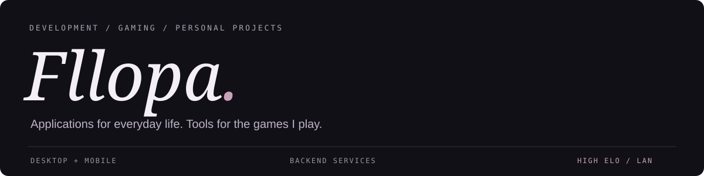

  

  <a href="https://t.me/Noname_crack">Telegram ↗</a> &nbsp; / &nbsp;
  <a href="https://github.com/BrainMcLore?tab=repositories">Repositories ↗</a> &nbsp; / &nbsp;
  <a href="#selected-projects">Selected projects ↓</a>

## About me

I'm **Fllopa**, a developer and competitive gamer. I work across application interfaces and backend services, building desktop utilities, mobile experiences, and tools for gaming communities.

My projects cover different parts of an application: user interfaces, account systems, shared data, automation, installers, and releases. I enjoy bringing those parts together into something people can use, with multilingual interfaces where they make sense.

Outside development, I play **Valorant** and **Counter-Strike 2** at **high elo**, with **LAN experience**. Gaming is also a source of project ideas: custom audio for Discord, a shared tactical space for CS2 teams, and separate profiles for Riot Mobile.

---

## Selected projects

### 01 / SoundSpace
*Discord audio, made personal.*

A Windows application for replacing Discord sounds with classic TeamSpeak presets, custom WAV/MP3 files, or sound packs shared by the community. The launcher brings sound selection, previews, pack management, and restoration into one interface.

- **Sound customization:** choose presets or your own files, preview audio before applying it, and select which supported events to customize.
- **Pack management:** save a selection as a sound pack, import an existing pack, and keep a personal library.
- **Community workshop:** browse, listen to, download, and publish packs through an account.
- **Restoration:** return to Discord's default sounds from the launcher.
- **Languages:** Russian, English, and Ukrainian.

C# · PowerShell · Windows · Inno Setup

[Source code ↗](https://github.com/BrainMcLore/discord-teamspeak-sounds) &nbsp; · &nbsp; [Download / releases ↗](https://github.com/BrainMcLore/discord-teamspeak-sounds/releases)

---

### 02 / Pet Tracker
*A pet-focused application project.*

A React project centered on pet tracking. It represents the application-interface side of my work, alongside the desktop utilities and team tools featured here.

The public client uses **React 19** and **JavaScript**, with React Testing Library included in its development setup. It has a separate repository from my gaming projects.

React · JavaScript · React Testing Library

[Source code ↗](https://github.com/BrainMcLore/pet-tracker-web)

---

### 03 / TeamSync
*A shared tactical workspace for CS2 teams.*

A native application for **Windows and Android**, built around a team's tactical library. Players can plan on maps, share drawings and notes, review prepared demos, and export printable playbooks.

- **Team collaboration:** accounts, invitations, roster roles, and shared tactical documents.
- **Tactical planning:** maps, drawings, notes, and team assignments.
- **Demo review:** Windows handles DEM processing; Android can open prepared reviews, with notes linked to rounds and ticks.
- **Shared changes:** queued updates during connection loss and separate copies for conflicting edits.
- **Playbooks:** PDF exports with tactical snapshots for offline review.
- **Languages:** Russian and English.

The clients use **Flutter and Dart**, backed by **Python, FastAPI, and PostgreSQL**. A Python companion handles heavier desktop processing.

Flutter · Dart · Python · FastAPI · PostgreSQL · SQLite

**Status:** active development. The repository is private; feature availability differs between published builds and the current development branch.

---

### 04 / Riot Profiles
*Independent Riot Mobile profiles, managed from Windows.*

A Python launcher for creating and managing separate Android emulator profiles. Each profile keeps its own accounts, installed apps, saved data, and Quick Boot state, while sharing a read-only base system image.

- **Profile management:** create named profiles, select one to launch, or bring an existing window forward.
- **Independent data:** keep Android app data and accounts separate between profiles.
- **Startup options:** resume a Quick Boot state or perform a cold boot without wiping data.
- **Desktop integration:** shortcuts for the launcher or a particular profile.
- **Distribution:** a Windows installer, a PowerShell installation helper, and automated release builds.
- **Languages:** English, Russian, Ukrainian, and Portuguese from Portugal.

Python · PowerShell · Android Emulator · GitHub Actions

[Source code ↗](https://github.com/BrainMcLore/riot-profiles) &nbsp; · &nbsp; [Download / releases ↗](https://github.com/BrainMcLore/riot-profiles/releases)

Independent community project; not affiliated with Riot Games or Google.

---

## Technology

| Focus | Tools used in my projects |
| :--- | :--- |
| Application interfaces | Flutter, Dart, React, JavaScript |
| Desktop software | C#, Python, PowerShell |
| Backend & storage | FastAPI, PostgreSQL, SQLite |
| Delivery | Git, GitHub Actions, Inno Setup |

  

---

## Beyond development

**Valorant & Counter-Strike 2 — high elo player with LAN experience.**

Competitive gaming is a big part of my life, alongside building software. My projects reflect both interests: some solve everyday problems, while others support the way players customize their setup or work with a team.

  
   
  A little anime atmosphere, between projects and matches.

## Contact

For project discussions, collaboration, or a conversation about games, reach me on **[Telegram ↗](https://t.me/Noname_crack)**.

Artwork credit

Existing illustration: [Gasai Yuno in the moonlight — WallpapersWide](https://wallpaperswide.com/gasai_yuno_in_the_moonlight-wallpapers.html). Artwork belongs to its respective creators and rights holders.

