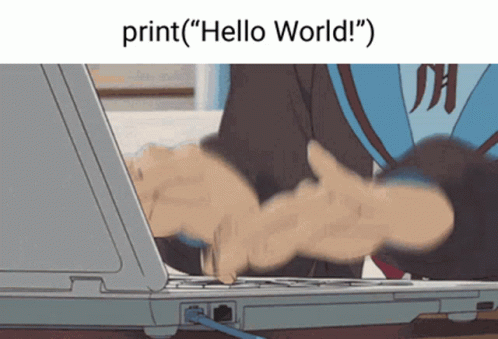
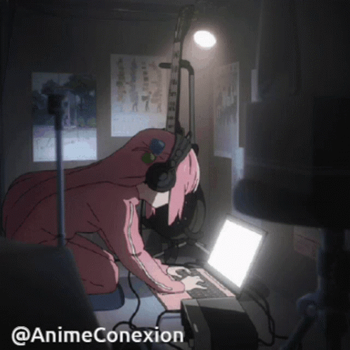
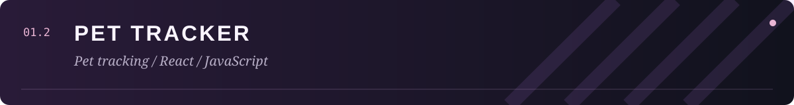
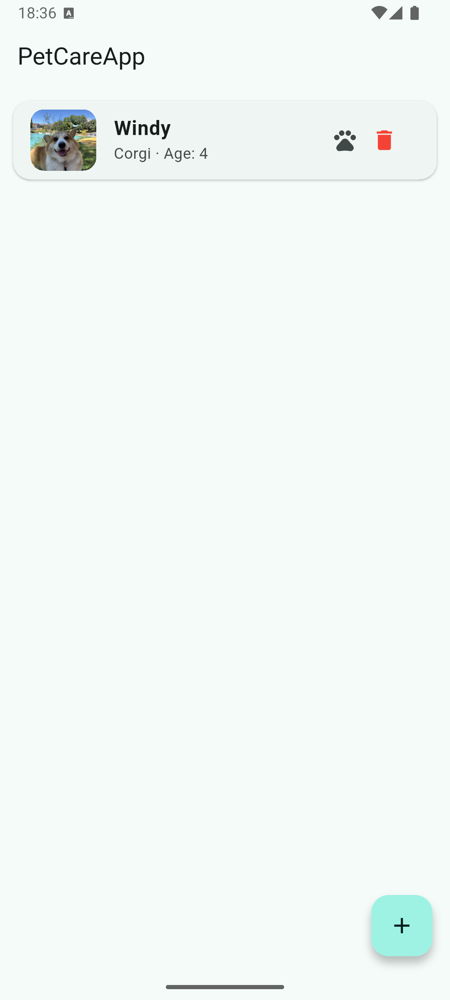
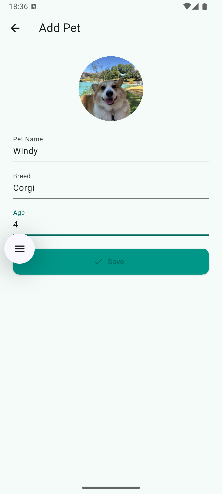
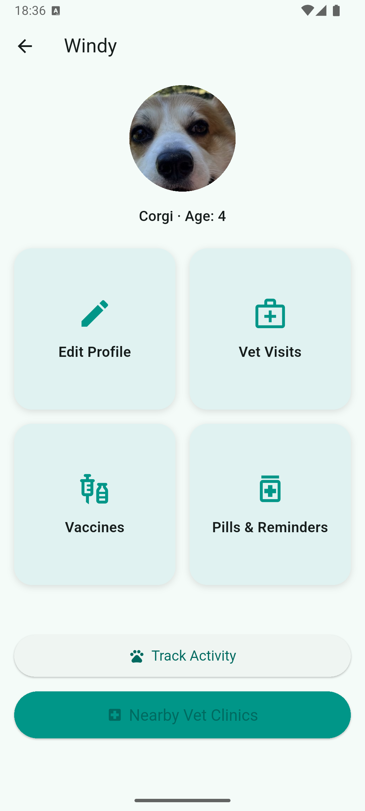
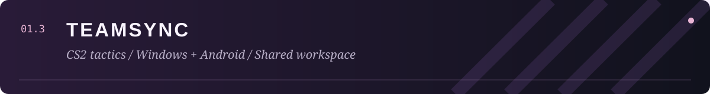
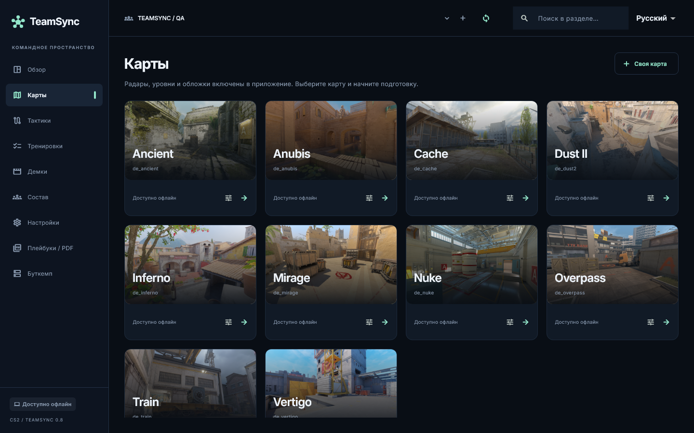
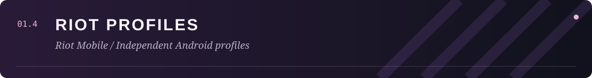
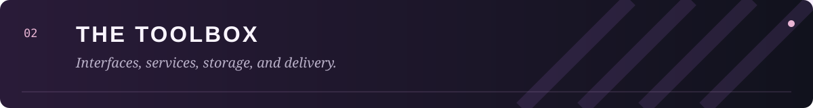

  

  <a href="https://t.me/Noname_crack">Telegram ↗</a> &nbsp; / &nbsp;
  <a href="https://github.com/BrainMcLore?tab=repositories">Repositories ↗</a> &nbsp; / &nbsp;
  <a href="#selected-projects">Selected projects ↓</a>

## 👋 About me

I'm **Fllopa**, an application developer. I work across application interfaces and backend services, building desktop utilities, mobile experiences, and backend services.

My projects cover different parts of an application: user interfaces, account systems, shared data, automation, installers, and releases. I enjoy bringing those parts together into something people can use, with multilingual interfaces where they make sense.

---

 

## 🚀 Selected projects

 

### 01 / SoundSpace
*🎧 Discord audio, made personal.*

A Windows application for replacing Discord sounds with classic TeamSpeak presets, custom WAV/MP3 files, or sound packs shared by the community. The launcher brings sound selection, previews, pack management, and restoration into one interface.

- 🎵 **Sound customization:** choose presets or your own files, preview audio before applying it, and select which supported events to customize.
- 📦 **Pack management:** save a selection as a sound pack, import an existing pack, and keep a personal library.
- 🌐 **Community workshop:** browse, listen to, download, and publish packs through an account.
- ↩️ **Restoration:** return to Discord's default sounds from the launcher.
- 🌍 **Languages:** Russian, English, and Ukrainian.

### ✨ From a sound idea to a personal setup

| Step | What the application does |
| :--- | :--- |
| 🎧 Choose | Start with TeamSpeak presets or select local WAV / MP3 files. |
| 🔊 Preview | Listen before applying and choose which supported events to customize. |
| 📦 Organize | Export a selection as a pack or import an existing one. |
| 🌐 Discover | Browse community packs, listen to previews, and download a selection. |
| ↩️ Restore | Return to the original Discord sounds from the launcher. |

The application supports seven Discord events, including microphone and audio toggles, participant joins and leaves, and your own disconnect. Sound packs can be shared through the workshop, while the launcher handles the local customization workflow. After a Discord update, the patch may need to be applied again.
C# · PowerShell · Windows · Inno Setup

[Source code ↗](https://github.com/BrainMcLore/discord-teamspeak-sounds) &nbsp; · &nbsp; [Download / releases ↗](https://github.com/BrainMcLore/discord-teamspeak-sounds/releases)

---

 

### 02 / Pet Tracker
*A pet-focused application project.*

Pet Tracker brings pet profiles and care-related information into a mobile interface. The project collection includes a **PetCareApp Android build** and a separate **React client repository**.

The mobile screenshots show a pet list, an add-pet form, and a profile dashboard. The dashboard groups care-related areas into large tiles so a pet's information is easy to navigate.

- 🐶 **Pet profiles:** photo, name, breed, and age presented together.
- ➕ **Profile creation:** a dedicated form for adding a pet and its basic details.
- 🩺 **Care dashboard:** entry points for veterinary visits, vaccinations, and medication reminders.
- 🐾 **Activity & services:** dashboard entries for activity tracking and nearby veterinary clinics.
- 📱 **Mobile interface:** a light palette, clear labels, and large touch targets.

The gallery shows the Android application. The separate React repository currently contains a starter client; the screenshots do not represent its current implementation.

### 📸 Application gallery

 &nbsp;
 &nbsp;

Pet list → Add a profile → Open the care dashboard

[Android project ↗](https://github.com/BrainMcLore/petcareapp) &nbsp; · &nbsp; [React client ↗](https://github.com/BrainMcLore/pet-tracker-web)

---

 

### 03 / TeamSync
*A shared tactical workspace for CS2 teams.*

A native application for **Windows and Android**, built around a team's tactical library. Players can plan on maps, share drawings and notes, review prepared demos, and export printable playbooks.

- 👥 **Team collaboration:** accounts, invitations, roster roles, and shared tactical documents.
- 🗺️ **Tactical planning:** maps, drawings, notes, and team assignments.
- 🎬 **Demo review:** Windows handles DEM processing; Android can open prepared reviews, with notes linked to rounds and ticks.
- 🔄 **Shared changes:** queued updates during connection loss and separate copies for conflicting edits.
- 📄 **Playbooks:** PDF exports with tactical snapshots for offline review.
- 🌍 **Languages:** Russian and English.

The clients use **Flutter and Dart**, backed by **Python, FastAPI, and PostgreSQL**. A Python companion handles heavier desktop processing.

### 📸 Inside the workspace

Map library — browse bundled maps and open a tactical workspace.

Tactical editor — player positions, utility markers, arrows, and versioned notes.

### 🔄 From planning to review

A team starts with its shared library, opens a map, and records a tactic using drawings and notes. Members can assign work, review prepared demos, and export tactical snapshots into a PDF playbook. The Windows companion handles heavier demo processing; Android provides access to the shared workspace and prepared reviews.

Account invitations and roles connect that workflow to an actual roster. When a connection is unavailable, edits are queued; conflicting changes are preserved as separate copies. The screenshots show development verification screens, rather than a guarantee that every feature is available in every published build.
Flutter · Dart · Python · FastAPI · PostgreSQL · SQLite

**Status:** active development. The repository is private; feature availability differs between published builds and the current development branch.

---

 

### 04 / Riot Profiles
*Independent Riot Mobile profiles, managed from Windows.*

A Python launcher for creating and managing separate Android emulator profiles. Each profile keeps its own accounts, installed apps, saved data, and Quick Boot state, while sharing a read-only base system image.

- 👤 **Profile management:** create named profiles, select one to launch, or bring an existing window forward.
- 🔐 **Independent data:** keep Android app data and accounts separate between profiles.
- ⚡ **Startup options:** resume a Quick Boot state or perform a cold boot without wiping data.
- 🖱️ **Desktop integration:** shortcuts for the launcher or a particular profile.
- 📥 **Distribution:** a Windows installer, a PowerShell installation helper, and automated release builds.
- 🌍 **Languages:** English, Russian, Ukrainian, and Portuguese from Portugal.

### ⚙️ How the launcher is organized

| Layer | Purpose |
| :--- | :--- |
| 👤 Profiles | Separate writable Android data, installed apps, accounts, and saved state. |
| 📦 Shared components | One read-only system image and shared Android tools. |
| ⚡ Launch control | Quick Boot, cold boot, and bringing an active profile forward. |
| 🖥️ Windows integration | Installer, launcher shortcuts, and per-profile desktop shortcuts. |

Create a named profile, launch Android, and sign into Riot Mobile inside the official app. The launcher manages the local emulator profiles; Google and Riot credentials are entered inside Android rather than into the launcher. Multiple profiles can run at once, subject to the computer's available resources.

The standalone Windows release does not require a separate Python or Android Studio installation. Release tooling also produces installers, source archives, and checksums through the project's build workflow.
Python · PowerShell · Android Emulator · GitHub Actions

[Source code ↗](https://github.com/BrainMcLore/riot-profiles) &nbsp; · &nbsp; [Download / releases ↗](https://github.com/BrainMcLore/riot-profiles/releases)

Independent community project; not affiliated with Riot Games or Google.

---

 

## 🧩 How the projects fit together

| | Project | What it focuses on |
| :---: | :--- | :--- |
| 🎧 | **SoundSpace** | Personalization, audio workflows, and a community workshop |
| 🐾 | **Pet Tracker** | Pet profiles, care navigation, and an Android companion |
| 🧠 | **TeamSync** | Shared team data, native clients, and tactical collaboration |
| 📱 | **Riot Profiles** | Desktop automation, profile separation, and application delivery |

### 💻 Interfaces → ⚙️ Services → 📦 Releases

The projects span different parts of software development. **SoundSpace** and **Riot Profiles** include Windows launchers and installation workflows. **TeamSync** connects native clients to shared backend services. **Pet Tracker** adds a pet-care interface and a separate React client repository to the collection.

### 🌍 Multilingual experiences

Language support is part of several projects: **SoundSpace** supports RU / EN / UK, **TeamSync** supports RU / EN, and **Riot Profiles** supports EN / RU / UK / PT-PT. Each project has its own scope and release status.

### 🔎 Explore the work

- 🎧 **Try a desktop app:** check the SoundSpace or Riot Profiles releases.
- 🐾 **Browse a client project:** explore the Pet Tracker repository.
- 🧠 **Read about the team workspace:** see the TeamSync section above; its repository is private.
- 💬 **Discuss a project:** reach out through Telegram.

---

## 🛠️ Technology

| Focus | Tools used in my projects |
| :--- | :--- |
| Application interfaces | Flutter, Dart, React, JavaScript |
| Desktop software | C#, Python, PowerShell |
| Backend & storage | FastAPI, PostgreSQL, SQLite |
| Delivery | Git, GitHub Actions, Inno Setup |

  

---

 

## 💬 Contact

For project discussions, collaboration, or questions about my applications, reach me on **[Telegram ↗](https://t.me/Noname_crack)**.

🎨 Artwork & animation credits

- [Coding animation — Tenor](https://tenor.com/view/coding-anime-gif-24565564).
- [Bocchi animation — Tenor / AnimeConexion](https://tenor.com/view/bocchi-the-rock-anime-gif-27049102).

Artwork and animations belong to their respective creators and rights holders.

