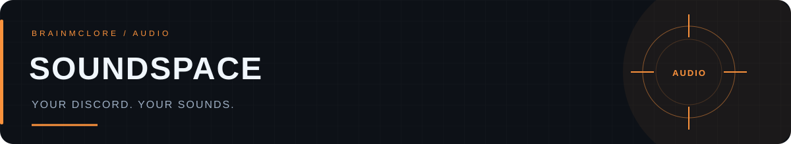
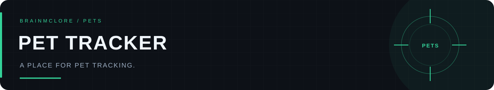
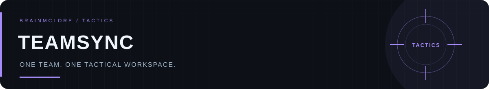
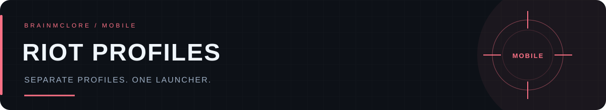
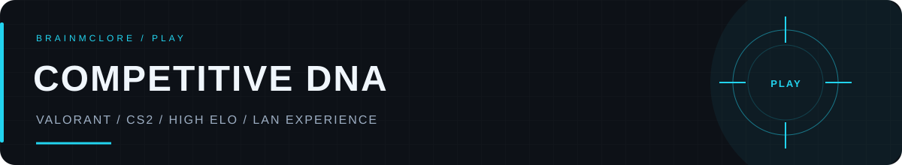

# 👋 Hey, I'm Volodymyr
### 💻 Application Developer · 🎮 Competitive Gamer · 🛠️ Tool Builder

I build applications and backend services for everyday tasks and gaming communities. 
🖥️ Desktop tools · 📱 Mobile experiences · ⚙️ Backend services

🎯 **Practical features** · 🌍 **Multilingual interfaces** · 🎮 **Tools for players**

---

## 🚀 Featured projects

### 🎧 SoundSpace
> **Your Discord. Your sounds.**

🖥️ Customize Discord audio on Windows with TeamSpeak presets, your own sounds, and community sound packs.

🎵 **WAV / MP3 support** · 🔊 **Audio previews** · 📦 **Pack import & export** 
🌐 **Community workshop** · ↩️ **Restore default sounds** · 🌍 **RU / EN / UK**

---

### 🐾 Pet Tracker
> **A place for pet tracking.**

🐶 A pet tracking project built with React.

---

### 🧠 TeamSync
> **One team. One tactical workspace.**

🎯 A native Windows and Android application for CS2 teams: plan tactics, share notes, review demos, and export printable playbooks.

🗺️ **Tactical maps** · 👥 **Team libraries & roles** · 📝 **Shared notes** 
🎬 **Demo reviews** · 📄 **PDF playbooks** · 🌍 **RU / EN**

🔒 **Private repository** · 🚧 **In active development**

---

### 📱 Riot Profiles · Riot Mobile Launcher
> **Separate profiles. One launcher.**

🖥️ A Python launcher for managing independent Android profiles for Riot Mobile on Windows.

👤 **Separate accounts & app data** · ⚡ **Quick Boot** · 🖱️ **Desktop shortcuts** 
📦 **Shared system image** · 🌍 **EN / RU / UK / PT-PT**

---

## 🛠️ My toolbox

  

**📱 Applications & interfaces**

**⚙️ Backend & automation**

**📦 Build & delivery**

---

## 🎮 Beyond the code

### 🏆 High Elo Player · 🏟️ LAN Experience

🏟️ High elo player in **Valorant** and **Counter-Strike 2**, with **LAN experience**. 

🎯 Competitive gaming is a big part of my life. 
💡 I also build tools for players and gaming communities.

---

## 🤝 Let's connect

Have a project in mind or want to talk about my tools? **Drop me a message.** 💬

**💻 Build something useful. 🎮 Play to improve. 🚀 Keep creating.**

[@BrainMcLore](https://github.com/BrainMcLore)

