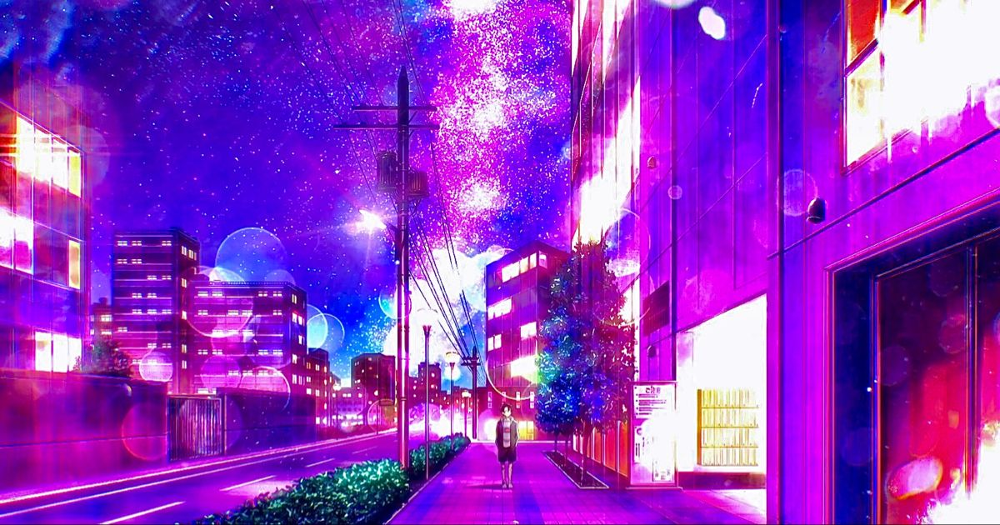

# 🌸 Fllopa
### 𝘊𝘰𝘥𝘦 · 𝘊𝘰𝘮𝘱𝘦𝘵𝘦 · 𝘊𝘳𝘦𝘢𝘵𝘦

**🖥️ Desktop & mobile apps · ⚙️ Backend services · 🎮 Gaming tools**

✦ ────────── 🌙 ────────── ✦

<table>
<tr>
<td width="38%" align="center">

</td>
<td width="62%">

### 🎀 Behind the nickname

Hey, I'm **Fllopa** — a developer and competitive gamer.

💻 I build applications and backend services for everyday tasks and gaming communities.

🌍 My projects include multilingual interfaces, desktop utilities, and tools for team collaboration.

🎯 Away from code, you'll find me playing **Valorant** and **Counter-Strike 2** at high elo, with **LAN experience**.

💬 Want to talk projects or gaming? [Message me on Telegram](https://t.me/Noname_crack).

</td>
</tr>
</table>

## 🌸 My project collection

*Built around real interests — sound, pets, teamwork, and gaming.*

<table>
<tr>
<td width="50%" valign="top">

### 🎧 SoundSpace
**Your Discord. Your sounds.**

A Windows app for customizing Discord audio with TeamSpeak presets, your own sounds, and community sound packs.

🎵 WAV / MP3 & audio previews 
📦 Pack import & export 
🌐 Community workshop 
↩️ Restore default sounds 
🌍 RU / EN / UK

</td>
<td width="50%" valign="top">

### 🐾 Pet Tracker
**A place for pet tracking.**

A pet tracking project built with React.

🐶 Pet-focused application project 
⚛️ React interface 
🟨 JavaScript

</td>
</tr>
<tr>
<td width="50%" valign="top">

### 🧠 TeamSync
**One team. One tactical workspace.**

A native Windows and Android workspace for CS2 teams.

🗺️ Tactical maps & shared notes 
👥 Team libraries, roles & invitations 
🎬 Demo reviews 
📄 Printable PDF playbooks 
🌍 RU / EN

🔒 **Private repository** · 🚧 **In development**

</td>
<td width="50%" valign="top">

### 📱 Riot Mobile · Riot Profiles
**Separate profiles. One launcher.**

A Python launcher for independent Android profiles for Riot Mobile on Windows.

👤 Separate accounts & app data 
⚡ Quick Boot 
🖱️ Desktop shortcuts 
📦 Shared system image 
🌍 EN / RU / UK / PT-PT

</td>
</tr>
</table>

✦ ────────── 🦋 ────────── ✦

## 🛠️ Tools behind the projects

**📱 Applications & interfaces**

**⚙️ Backend & automation**

**📦 Build & delivery**

✦ ────────── 🎮 ────────── ✦

## 🏆 Competitive side

### 🎯 High elo. 🏟️ LAN experience.

**High elo player in Valorant and Counter-Strike 2, with LAN experience.**

🎧 Competitive gaming is a big part of my life. 
🧠 That interest also inspires the tools I build for players and teams.

✦ ────────── 💌 ────────── ✦

## Let's connect

**Projects, collaboration, or a conversation about games — my DMs are open.**

🌸 **Build something useful. Play to improve. Keep creating.** 🌸

🎨 Artwork sources

- Main character image: supplied profile reference.
- Night city: [source page](https://www.pinterest.com/pin/call-of-the-night-in-2022--1548181158503969/).
- Moonlight illustration: [Gasai Yuno in the moonlight — WallpapersWide](https://wallpaperswide.com/gasai_yuno_in_the_moonlight-wallpapers.html).
- Artwork belongs to its respective creators and rights holders. Images are existing artwork; no AI image generation was used for this profile.

