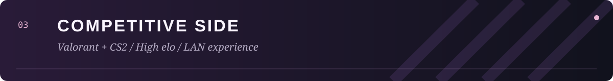
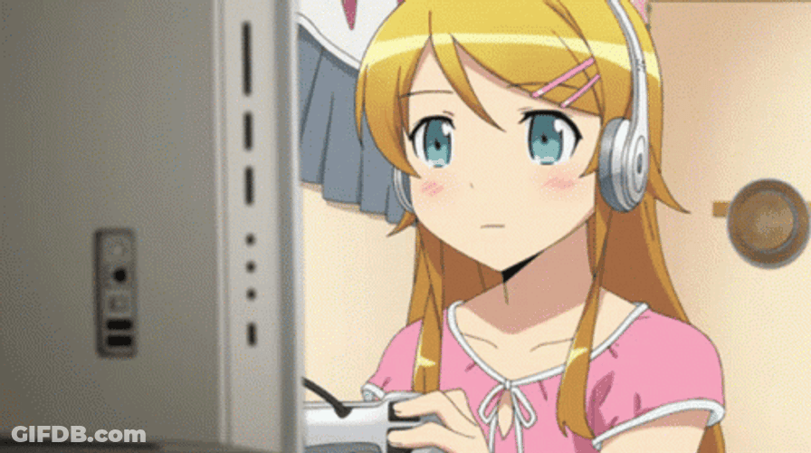

  

  <a href="https://t.me/Noname_crack">Telegram ↗</a> &nbsp; / &nbsp;
  <a href="https://github.com/BrainMcLore?tab=repositories">Repositories ↗</a> &nbsp; / &nbsp;
  <a href="#selected-projects">Selected projects ↓</a>

## 👋 About me

I'm **Fllopa**, a developer and competitive gamer. I work across application interfaces and backend services, building desktop utilities, mobile experiences, and tools for gaming communities.

My projects cover different parts of an application: user interfaces, account systems, shared data, automation, installers, and releases. I enjoy bringing those parts together into something people can use, with multilingual interfaces where they make sense.

Outside development, I play **Valorant** and **Counter-Strike 2** at **high elo**, with **LAN experience**. Gaming is also a source of project ideas: custom audio for Discord, a shared tactical space for CS2 teams, and separate profiles for Riot Mobile.

---

 

## 🚀 Selected projects

 

### 01 / SoundSpace
*🎧 Discord audio, made personal.*

A Windows application for replacing Discord sounds with classic TeamSpeak presets, custom WAV/MP3 files, or sound packs shared by the community. The launcher brings sound selection, previews, pack management, and restoration into one interface.

- 🎵 **Sound customization:** choose presets or your own files, preview audio before applying it, and select which supported events to customize.
- 📦 **Pack management:** save a selection as a sound pack, import an existing pack, and keep a personal library.
- 🌐 **Community workshop:** browse, listen to, download, and publish packs through an account.
- ↩️ **Restoration:** return to Discord's default sounds from the launcher.
- 🌍 **Languages:** Russian, English, and Ukrainian.

C# · PowerShell · Windows · Inno Setup

[Source code ↗](https://github.com/BrainMcLore/discord-teamspeak-sounds) &nbsp; · &nbsp; [Download / releases ↗](https://github.com/BrainMcLore/discord-teamspeak-sounds/releases)

---

 

### 02 / Pet Tracker
*A pet-focused application project.*

A React project centered on pet tracking. It represents the application-interface side of my work, alongside the desktop utilities and team tools featured here.

The public client uses **React 19** and **JavaScript**, with React Testing Library included in its development setup. It has a separate repository from my gaming projects.

React · JavaScript · React Testing Library

[Source code ↗](https://github.com/BrainMcLore/pet-tracker-web)

---

 

### 03 / TeamSync
*A shared tactical workspace for CS2 teams.*

A native application for **Windows and Android**, built around a team's tactical library. Players can plan on maps, share drawings and notes, review prepared demos, and export printable playbooks.

- 👥 **Team collaboration:** accounts, invitations, roster roles, and shared tactical documents.
- 🗺️ **Tactical planning:** maps, drawings, notes, and team assignments.
- 🎬 **Demo review:** Windows handles DEM processing; Android can open prepared reviews, with notes linked to rounds and ticks.
- 🔄 **Shared changes:** queued updates during connection loss and separate copies for conflicting edits.
- 📄 **Playbooks:** PDF exports with tactical snapshots for offline review.
- 🌍 **Languages:** Russian and English.

The clients use **Flutter and Dart**, backed by **Python, FastAPI, and PostgreSQL**. A Python companion handles heavier desktop processing.

Flutter · Dart · Python · FastAPI · PostgreSQL · SQLite

**Status:** active development. The repository is private; feature availability differs between published builds and the current development branch.

---

 

### 04 / Riot Profiles
*Independent Riot Mobile profiles, managed from Windows.*

A Python launcher for creating and managing separate Android emulator profiles. Each profile keeps its own accounts, installed apps, saved data, and Quick Boot state, while sharing a read-only base system image.

- 👤 **Profile management:** create named profiles, select one to launch, or bring an existing window forward.
- 🔐 **Independent data:** keep Android app data and accounts separate between profiles.
- ⚡ **Startup options:** resume a Quick Boot state or perform a cold boot without wiping data.
- 🖱️ **Desktop integration:** shortcuts for the launcher or a particular profile.
- 📥 **Distribution:** a Windows installer, a PowerShell installation helper, and automated release builds.
- 🌍 **Languages:** English, Russian, Ukrainian, and Portuguese from Portugal.

Python · PowerShell · Android Emulator · GitHub Actions

[Source code ↗](https://github.com/BrainMcLore/riot-profiles) &nbsp; · &nbsp; [Download / releases ↗](https://github.com/BrainMcLore/riot-profiles/releases)

Independent community project; not affiliated with Riot Games or Google.

---

 

## 🧩 How the projects fit together

| | Project | What it focuses on |
| :---: | :--- | :--- |
| 🎧 | **SoundSpace** | Personalization, audio workflows, and a community workshop |
| 🐾 | **Pet Tracker** | A pet-focused React application interface |
| 🧠 | **TeamSync** | Shared team data, native clients, and tactical collaboration |
| 📱 | **Riot Profiles** | Desktop automation, profile separation, and application delivery |

### 💻 Interfaces → ⚙️ Services → 📦 Releases

The projects span different parts of software development. **SoundSpace** and **Riot Profiles** include Windows launchers and installation workflows. **TeamSync** connects native clients to shared backend services. **Pet Tracker** adds a React client to the collection.

### 🌍 Multilingual experiences

Language support is part of several projects: **SoundSpace** supports RU / EN / UK, **TeamSync** supports RU / EN, and **Riot Profiles** supports EN / RU / UK / PT-PT. Each project has its own scope and release status.

### 🔎 Explore the work

- 🎧 **Try a desktop app:** check the SoundSpace or Riot Profiles releases.
- 🐾 **Browse a client project:** explore the Pet Tracker repository.
- 🧠 **Read about the team workspace:** see the TeamSync section above; its repository is private.
- 💬 **Discuss a project:** reach out through Telegram.

---

## 🛠️ Technology

| Focus | Tools used in my projects |
| :--- | :--- |
| Application interfaces | Flutter, Dart, React, JavaScript |
| Desktop software | C#, Python, PowerShell |
| Backend & storage | FastAPI, PostgreSQL, SQLite |
| Delivery | Git, GitHub Actions, Inno Setup |

  

---

 

## 🎮 Beyond development

### 🏆 High elo player · 🏟️ LAN experience

**Valorant & Counter-Strike 2 — high elo player with LAN experience.**

🎯 **Games:** Valorant and Counter-Strike 2. 
🏟️ **Experience:** online competitive play and LAN. 
🧠 **Interests:** team coordination, tactical planning, and gaming tools. 
🎧 **Off the server:** anime, software, and personal projects.

Competitive gaming is a big part of my life, alongside building software. My projects reflect both interests: some solve everyday problems, while others support the way players customize their setup or work with a team.

   
  
   
  A little anime atmosphere, between projects and matches.

 

## 💬 Contact

For project discussions, collaboration, or a conversation about games, reach me on **[Telegram ↗](https://t.me/Noname_crack)**.

🎨 Artwork & animation credits

- [Coding animation — Tenor](https://tenor.com/view/coding-anime-gif-24565564).
- [Bocchi animation — Tenor / AnimeConexion](https://tenor.com/view/bocchi-the-rock-anime-gif-27049102).
- [Gaming animation — GIFDB](https://gifdb.com/gif/serious-anime-gaming-girl-btwbo1lrl0qrvoer.html).

Existing illustration: [Gasai Yuno in the moonlight — WallpapersWide](https://wallpaperswide.com/gasai_yuno_in_the_moonlight-wallpapers.html). Artwork belongs to its respective creators and rights holders.

